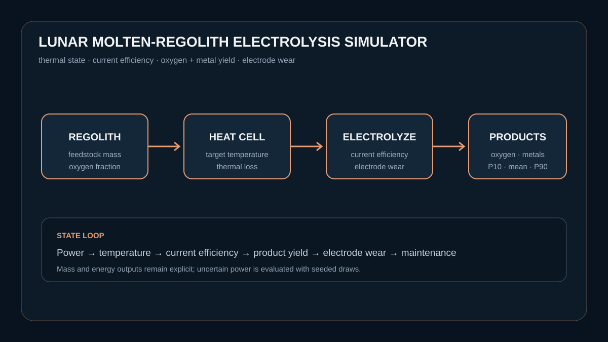

# Lunar Molten-Regolith Electrolysis Simulator

A thermal and electrochemical process model for producing oxygen and metal
co-products from lunar regolith. It connects cell warm-up, heat loss, power,
current efficiency, material yield, electrode wear, maintenance, and output
uncertainty.



```bash
python -m pip install -e .
python model.py
pytest -q
```

## The question

How much oxygen and metal product can a molten-regolith electrolysis cell
produce after accounting for thermal energy, conversion efficiency, electrode
degradation, maintenance, and uncertain power delivery?

The simulator first heats the cell to its operating range. During production,
available power and current efficiency constrain each batch. Efficiency falls
with electrode wear and temperature deviation; maintenance restores part of
the cell state. A seeded ensemble reports an oxygen-output range.

## Outputs

- processed and unprocessed regolith
- oxygen and metal co-product mass
- warm-up, operating, and maintenance hours
- energy used and specific energy per kilogram of oxygen
- current efficiency and electrode wear
- P10, mean, and P90 oxygen production

## Evidence base

- NASA, *Production of Oxygen from Lunar Regolith Using Molten Oxide
  Electrolysis*: https://ntrs.nasa.gov/citations/20090018064
- ESA, *ESA opens oxygen plant — making air out of moondust*:
  https://www.esa.int/Enabling_Support/Space_Engineering_Technology/ESA_opens_oxygen_plant_making_air_out_of_moondust
- NASA, *ISRU Gap Assessment Report*:
  https://ntrs.nasa.gov/citations/20210022137

## Limits

This is a low-order research simulator, not an electrochemical design tool or
flight-qualified control system. Default kinetic, yield, heat-loss, and wear
parameters are explicit illustrative assumptions. The model omits melt
chemistry by mineral phase, gas handling, electrode geometry, corrosion
mechanisms, contamination, and detailed thermal-vacuum hardware.
